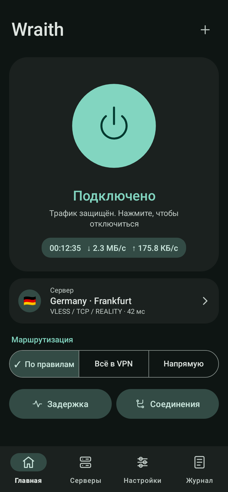
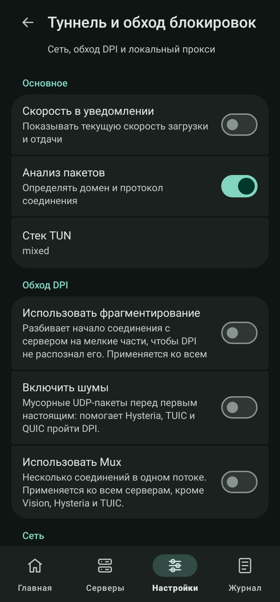

# Wraith

Android VPN client for VLESS / VMess / Trojan / Shadowsocks / Hysteria2 / TUIC, with two cores: **Xray** and **sing-box**. The interface is Material 3 with Material You colours. It imports Happ- and v2rayNG-style subscriptions and full Xray JSON, including multi-server configs with balancers (`leastPing` + `observatory`).

> Русский: Wraith — Android-клиент для VLESS/VMess/Trojan/SS/Hysteria2/TUIC на ядрах Xray и sing-box, с дизайном Material 3. Он понимает подписки, полный Xray JSON и авто-конфиги с балансировщиками. Анонимной статистики нет; при проверке обновлений отправляется только версия приложения.

<p>



</p>

## Features

- **Two engines.** Xray runs in an isolated `:xray` process (libXray). sing-box runs in the app process (libbox). The engine is chosen per server automatically.
- **Complex Xray configs work as written.**
  - Provider balancers, observatory, `dialerProxy` chains, fragment and noise dialers are kept.
  - Multi-server documents without a balancer can get an automatic `leastPing` balancer ("fastest server automatically").
- **Latency checks.** TCP, ICMP, or a real HTTP GET/HEAD through every server of a pool. The proxy check runs in a separate short-lived Xray instance, with no VPN needed.
- **Subscriptions.** Usage and expiry, announcements, update interval, QR / clipboard / file import, share links and QR export.
- **Routing.** Domain / IP / geosite / geoip / app rules, per-app split tunnelling, IPv6 handling, MTU, TLS fragmentation, mux.
- **DNS.** Uses the phone's own DNS by default. The provider's DNS from JSON, or your own DoH/DoT address, are opt-in switches.
- **Privacy.**
  - No analytics or telemetry.
  - Updates come from GitHub Releases; the check sends only `User-Agent: Wraith/<version>/Android`.
  - Settings are stored encrypted with the Android Keystore; backups are off.
- **Hardening.**
  - Core control ports (Xray metrics, Clash API) are random per session and the Clash API uses a session secret.
  - The local SOCKS/HTTP proxy is off by default, and LAN access requires a password.
  - A `wraith://` link from a web page cannot silently turn the VPN off.
  - Provider configs cannot open their own API listeners or write log files.
- Quick Settings tile, boot start, `wraith://connect` / `disconnect` / `toggle` automation links (Happ-compatible `happ://` too).

A Windows WPF client (sing-box, system proxy or TUN) lives in [`Wraith.Windows/`](Wraith.Windows). It is less mature than the Android app.

## Building (Android)

Requirements: JDK 17+, Android SDK 35 (build-tools 35.0.0), Gradle 8.10.2.

1. Put the two native core libraries in `app/libs/`. They are not committed because of their size.
   - `libXray.aar`: libXray v26.9.30 (MIT), from the [official releases](https://github.com/XTLS/libXray/releases).
   - `libbox.aar`: sing-box 1.14.1 built with the Wraith patches from [`third_party/wraith-core`](third_party/wraith-core). The patches add per-outbound HTTP probes, `wraith_fragment` / `wraith_noise` dialers and Reality X25519MLKEM768 compatibility; a stock libbox rejects Wraith's configs.

   Prebuilt copies of both are attached to the GitHub releases of this repository.
2. Write `sdk.dir=<path to Android SDK>` into `local.properties`.
3. Build:

   ```sh
   ./gradlew testReleaseUnitTest assembleRelease
   ```

   Then sign the APK with your own key.

### Rebuilding libbox

```sh
git clone --branch v1.14.1 https://github.com/SagerNet/sing-box && cd sing-box
sh ../third_party/wraith-core/apply.sh .
go install github.com/sagernet/gomobile/cmd/gomobile@v0.1.12
go install github.com/sagernet/gomobile/cmd/gobind@v0.1.12
gomobile bind -target android/arm64,android/amd64 -androidapi 26 -javapkg io.nekohasekai -libname box -trimpath \
  -ldflags "-s -w -checklinkname=0 -X github.com/sagernet/sing-box/constant.Version=1.14.1" \
  -tags with_gvisor,with_quic,with_wireguard,with_utls,with_clash_api,with_low_memory -o libbox.aar ./experimental/libbox
```

### UI screenshots without a device

```sh
WRAITH_SCREENS=1 ./gradlew testReleaseUnitTest --tests '*ScreenshotTest*'
```

The PNGs are written to `app/build/screens`, rendered with Robolectric.

### Updates

The app checks the latest GitHub release of `trinity13338/wraith` (`UpdateChecker.REPO`) and installs its APK only if the SHA-256 digest GitHub reports for the asset matches. Downloads may only reach GitHub hosts. Forks should change `REPO`.

## License

Wraith is licensed under **GPL-3.0-or-later** (see [LICENSE](LICENSE)), because it links sing-box (GPL-3.0-or-later). Third-party components:

- Xray-core (MPL-2.0)
- libXray (MIT)
- ZXing / zxing-android-embedded (Apache-2.0)
- Material Components and AndroidX (Apache-2.0)
- geoip/geosite data from the v2fly / Loyalsoldier projects

See [THIRD_PARTY_NOTICES.md](THIRD_PARTY_NOTICES.md).

Wraith is a client only. No servers are bundled, and no conversion service is used.
